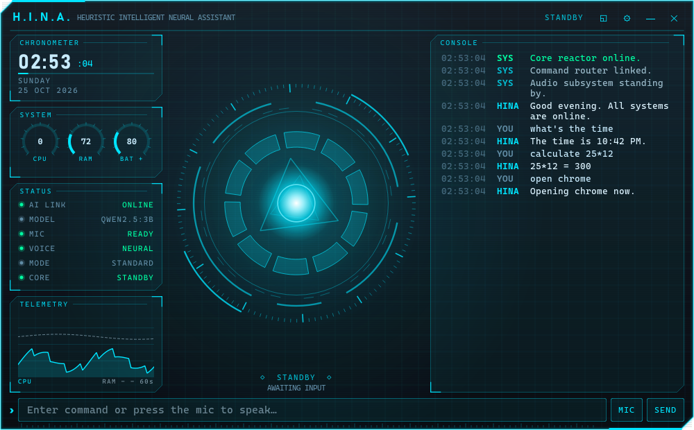
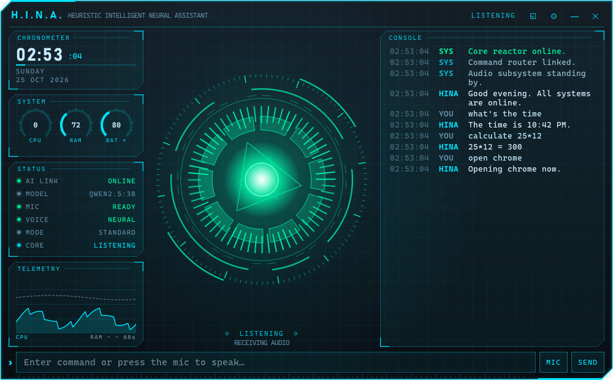
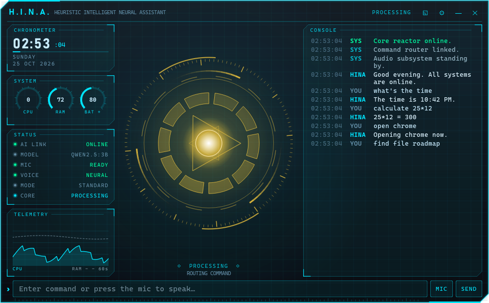
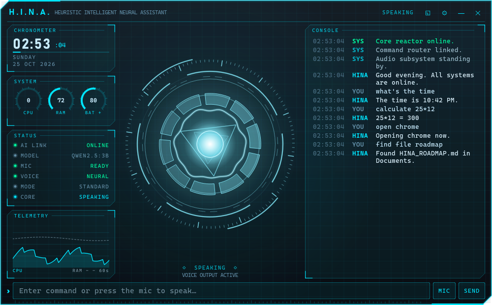
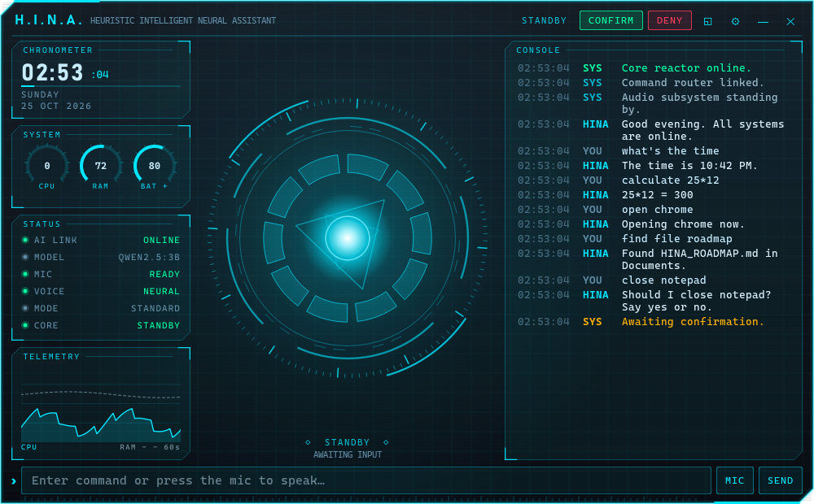
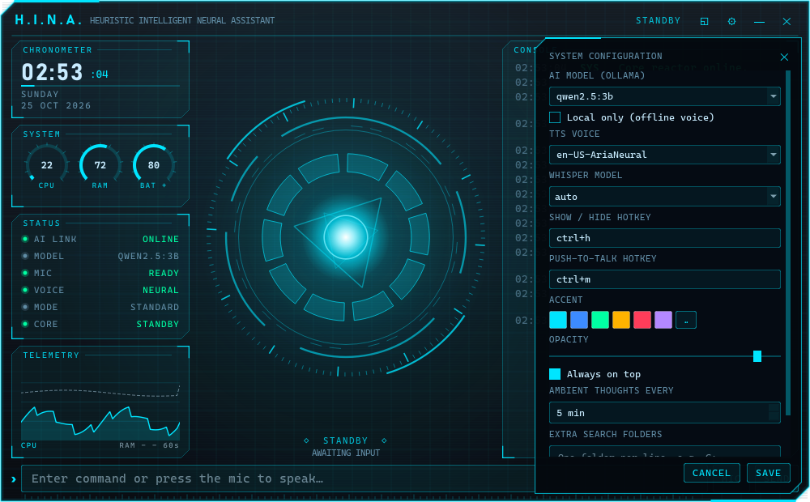
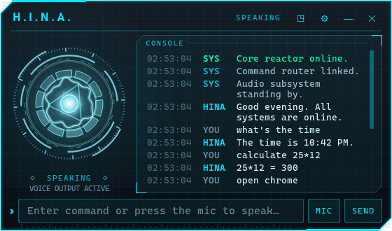

# 🌸 Project Hina

<div align="center">

### *An Anime-Inspired Ambient Desktop Assistant*

A modular desktop companion built with Python, featuring voice interaction, persistent memory, animated UI systems, personality-driven responses, and future-ready AI architecture.

---


</div>

---

# ✨ Overview

Project Hina is a floating desktop assistant designed to provide a more immersive and personality-driven interaction experience compared to traditional utility assistants.

The project combines:

* Modern modular architecture
* Anime-inspired desktop aesthetics
* Voice interaction
* Persistent memory systems
* Personality-based responses
* Ambient animations
* Future AI integration capabilities

Rather than functioning solely as a command executor, Hina is designed as an evolving desktop companion framework focused on presence, responsiveness, and extensibility.

---

# 🌸 Current Features

## 🪟 Ambient Desktop Interface

* Floating borderless assistant window
* Sakura-inspired visual theme
* Animated falling petal effects
* Smooth draggable interface
* Pulsing visual response effects
* Always-on-top assistant mode
* Global hotkey toggle (`Ctrl + H`)

---

## 🎤 Voice Interaction

* Edge-TTS powered voice output
* Spoken assistant responses
* Countdown voice announcements
* Startup greeting interaction
* **Voice input**: click the 🎤 button (or press `Ctrl+M`), speak, and Hina transcribes it offline with faster-whisper (`small.en` on an NVIDIA GPU, `base.en` on CPU, downloaded on first use; override with `HINA_STT_MODEL`). Spoken maths works ("calculate 25 times 12"), and your saved name is spelled correctly and runs it like typed input. Recording stops after a pause; click ■ to cancel. Hina won't listen while she is speaking. Needs `sounddevice` and a microphone; without them she says so politely. Check your mic with `python -m core.stt`, and pick a different one with `HINA_MIC_DEVICE` (index or part of its name).

---

## 🧠 Persistent Memory System

Hina currently remembers:

* User name
* Favorite applications
* Recently opened applications
* Recently accessed files
* The conversation itself (restored in the HUD console after a restart)
* Your name: `my name is Malu` / `call me Malu`, and `what's my name?`
* Facts you ask her to keep: `remember that my sister is called Maya`,
  `what do you know about me?`, `forget Maya` (forgetting several facts asks first)

Everything lives in `%APPDATA%\ProjectHina\` (set `HINA_DATA_DIR` to move it):
`user_profile.json` (name, apps, favourites; the old `memory/user_profile.json` is
copied there on first run) and `hina_memory.db` (SQLite: history, a rolling summary
of older turns, facts). **Private mode** in the HUD settings stops anything new
being recorded; the settings' Memory section also lists and deletes facts and
clears the history.

### Chat mode

Anything that isn't a command (after Ollama's tool calling has had a go) is a real
conversation with the local model: a calm, J.A.R.V.I.S.-style persona that knows
your name, the time, your recent apps, the last ~10 exchanges, a summary of older
ones and the facts relevant to what you said. If Ollama isn't running Hina answers
instantly with a short canned reply instead.

Example:

```bash
favorite app chrome as browser
open browser
```

---

## ⚡ Command System

### Application Management

```bash
open chrome
close spotify
restart vscode
```

### File & Folder Operations

```bash
open file notes.txt
find folder downloads
```

### Utility Commands

```bash
tell time
tell date
battery
disk usage
calculate 25*12
```

### Timers & Countdown

```bash
timer 60
countdown 10
cancel timer
```

---

## 🎭 Personality Engine

Hina includes a modular personality framework capable of dynamically altering assistant responses.

Current personality presets:

* Calm 🌸
* Tsundere 💢

The architecture is designed to support:

* AI-generated responses
* Emotional state systems
* Mood adaptation
* Context-aware dialogue generation

---

# 🏗 Project Architecture

The project has been fully refactored into a scalable modular architecture.

```text
project_hina/
│
├── gui.py
├── main.py
├── parser.py
├── actions.py
├── memory.py
├── voice.py
│
├── core/
│   ├── assistant.py
│   ├── dispatcher.py
│   ├── command_router.py
│   ├── stt.py
│   ├── startup.py
│   ├── countdown.py
│   └── personality_engine.py
│
├── ui/
│   ├── theme.py
│   ├── animations.py
│   ├── effects.py
│   ├── widgets.py
│   └── window.py
│
├── utils/
│   ├── constants.py
│   ├── helpers.py
│   └── logger.py
│
├── memory/
│   └── user_profile.json
│
└── assets/
    ├── avatars/
    ├── icons/
    └── sounds/
```

---

# ⚙️ Technologies Used

| Technology    | Purpose                   |
| ------------- | ------------------------- |
| Python 3.11+  | Core application          |
| CustomTkinter | UI framework              |
| Edge-TTS      | Voice synthesis           |
| Pygame        | Audio playback            |
| Keyboard      | Global hotkeys            |
| JSON / SQLite | Profile, history and facts |
| Threading     | Background task execution |

---

# 🚀 Installation

## 1. Clone the Repository

```bash
git clone https://github.com/your-username/project_hina.git
cd project_hina
```

---

## 2. Install Dependencies

```bash
pip install -r requirements.txt
```

---

## 3. Launch Hina

### HUD Mode (new, PySide6)

```bash
python hina.py
```

`python hina.py --classic` (or `python gui.py`) starts the old customtkinter window,
which stays as a fallback. `hina.py` also falls back to it if PySide6 isn't installed.

### Classic GUI Mode

```bash
python gui.py
```

### CLI Mode

```bash
python main.py
```

---

# 🎮 Controls

| Action                  | Shortcut   |
| ----------------------- | ---------- |
| Toggle Assistant Window | `Ctrl + H` |
| Push-to-talk (start / stop) | `Ctrl + M` |
| Hide window / close settings | `Esc` |

Both hotkeys can be changed in the HUD's settings panel.

---

# 🛰 HUD Interface (`ui_qt/`)

A Qt 6 (PySide6) interface in a J.A.R.V.I.S. style: a frameless, translucent,
always-on-top HUD with a live arc-reactor core.



| Listening | Thinking | Speaking |
| --- | --- | --- |
|  |  |  |

| Confirmation | Settings | Compact |
| --- | --- | --- |
|  |  |  |

* **Core**: a 60 fps QPainter arc reactor. It turns slowly when idle, follows the live mic level
  when listening, spins amber segments while thinking, and shows a waveform with ripples while speaking.
* **Console**: scrollback of your commands, Hina's replies (typewriter reveal) and system lines.
* **HUD panels**: clock, CPU/RAM/battery gauges, CPU/RAM telemetry graph (psutil),
  and status for the Ollama link, model, mic, voice, mode and core.
* **Confirmations**: CONFIRM / DENY buttons appear in the title strip for "Should I?" actions.
* **Window**: drag by the title strip; the position and the compact/expanded choice are remembered.
  `—` hides the window to the tray, `✕` shuts Hina down. The tray icon offers show/hide, settings and quit.
* **Settings** (gear): saved to `%APPDATA%\ProjectHina\settings.json`, next to the action log.

| Setting | Wired to |
| --- | --- |
| AI model | `core.ai_engine.MODEL` (live) |
| Local only | turns off cloud edge-tts and uses the offline pyttsx3 voice |
| TTS voice | `voice.VOICE` (edge-tts voice name) |
| Whisper model | next mic use (`auto` = small.en on GPU, base.en on CPU) |
| Hotkeys, accent, opacity, always-on-top | live |
| Ambient thoughts | how often idle "thoughts" appear in the console (0 = off) |
| Search folders | written to `search_folders.txt`, which file search already reads |

The classic `gui.py` window does not read `settings.json`.

Drop Orbitron / Rajdhani / JetBrains Mono `.ttf` files into `ui_qt/fonts/` to use them.
Otherwise the HUD uses Bahnschrift, Cascadia Mono or Consolas.

Regenerate the screenshots headlessly with `python -m ui_qt.screenshots`.
Tests: `python -m pytest tests -q` (the Qt tests run offscreen and need `pytest-qt`).

---

# 🧪 Stability Status

### Current Build Status

* ✅ Modular architecture completed
* ✅ Voice system stabilized
* ✅ Memory system operational
* ✅ Personality engine operational
* ✅ Animation systems modularized
* ✅ Command dispatcher implemented
* ✅ Parser routing stabilized

---

# 🧠 Future Roadmap

## Planned Features

### 🤖 AI Integration

* Local LLM integration
* AI-generated personality responses
* Context-aware dialogue generation

### 🎤 Voice Input

* Speech recognition
* Wake word activation
* Continuous listening mode

### 👀 Vision Systems

* Screenshot understanding
* OCR support
* Desktop context awareness

### 🎭 Character Systems

* Dynamic mood engine
* Adaptive personality shifting
* Emotion-aware interactions

### 🪄 Avatar Systems

* Live2D integration
* Animated assistant avatars
* Future 3D avatar support

### 📚 Behavioral Learning

* Usage habit analysis
* Workflow prediction
* Personalized suggestions

---

# 🎯 Design Philosophy

Project Hina is designed around the concept of:

> *“An assistant that feels present, not just functional.”*

The project prioritizes:

* Modular scalability
* Ambient interaction design
* Personality-driven responses
* Clean software architecture
* Future AI experimentation

The long-term goal is to evolve Hina into a lightweight intelligent desktop companion framework capable of integrating advanced AI systems while maintaining a calm and aesthetically pleasing user experience.

---

# ⚠️ Disclaimer

Project Hina is currently under active development.

Some systems are experimental and may evolve significantly as future AI, voice, and interaction systems are integrated.

---

# 🌸 Project Status

### **Hina V1 — Stable Architecture Build**

The project has successfully transitioned from an experimental prototype into a structured, modular desktop assistant framework prepared for long-term expansion and AI integration.

## Adding a command

Commands live in a single registry: write one `@tool(...)` function in `tools/` and the parser, AI tool schema, router, dispatcher and permission tier all pick it up. See [tools/README.md](tools/README.md).
